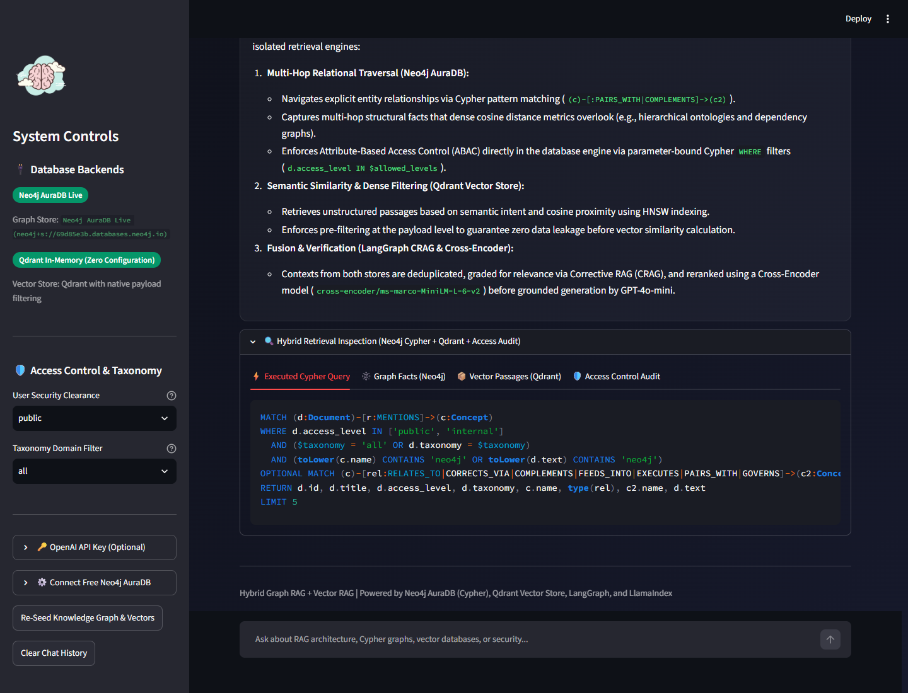
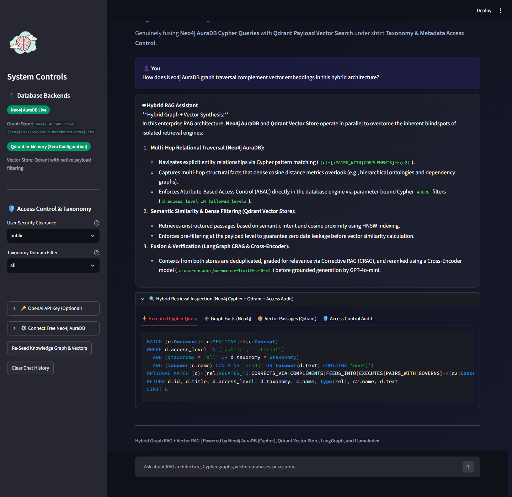
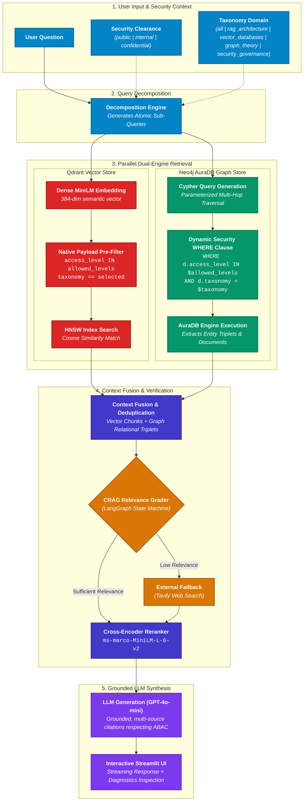
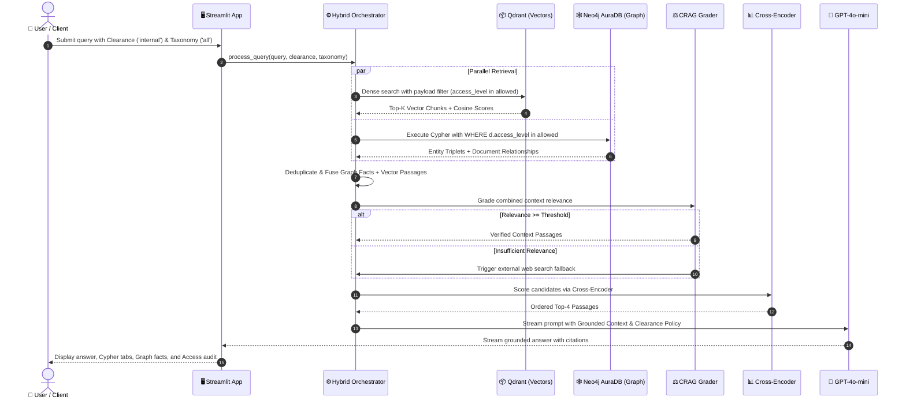

# 🧠 Enterprise Hybrid Graph RAG + Vector RAG

[](https://github.com/meenub255/Next_Generation_RAG)
[](https://www.python.org/)
[](https://neo4j.com/cloud/aura-free/)
[](https://qdrant.tech/)
[](https://streamlit.io/)
[](https://opensource.org/licenses/MIT)

A production-grade **Hybrid Graph RAG + Vector RAG** system that bridges unstructured dense semantic search with structured graph relational traversal. It combines **Neo4j AuraDB (Cypher Queries)** and **Qdrant Vector Store (Dense Embeddings)** with strict **Attribute-Based Access Control (ABAC)**, Query Decomposition, Corrective RAG (CRAG) evaluation, and Cross-Encoder Reranking.

🔗 **GitHub Repository:** [https://github.com/meenub255/Next_Generation_RAG](https://github.com/meenub255/Next_Generation_RAG)

---

## 📸 System Screenshots & UI Workflow

The interactive Streamlit interface provides real-time visibility into the dual-engine retrieval pipeline, security enforcement, and relational graph facts.

### 1. Streamlit Control Center & Real-Time Monitoring
The dashboard displays live backend connection badges (Neo4j AuraDB and Qdrant), role-based security clearance levels, and domain taxonomy filters.



---

### 2. End-to-End Hybrid Retrieval & Inspection
Every query runs through query decomposition, parallel retrieval, CRAG grading, and cross-encoder reranking. The inspection panel allows developers and security auditors to view:
- **⚡ Parameterized Cypher Queries** executed against Neo4j AuraDB.
- **🕸️ Relational Graph Facts & Triplets** extracted via multi-hop traversal.
- **📦 Dense Vector Passages** retrieved from Qdrant with cosine similarity scores.
- **🛡️ Access Control Audit Logs** detailing granted vs blocked documents.



---

## 🏗️ End-to-End Architecture & Workflow

The architecture unites graph theory and dense vector space while strictly preserving enterprise security boundaries at the database engine level.



---

## ⚡ Step-by-Step Retrieval Lifecycle



---

## ✨ Key Capabilities

| Component | Description |
|---|---|
| 🕸️ **Neo4j AuraDB Graph RAG** | Executes Cypher pattern queries across entity/concept relationships on free Neo4j AuraDB instances or the embedded in-memory Cypher simulator |
| 📦 **Qdrant Vector Store** | Dense semantic similarity search using Qdrant with hardware-accelerated HNSW indexing and payload filtering |
| 🛡️ **Access Control & Taxonomy (ABAC)** | Attribute-Based Access Control with hierarchical clearance levels (`public`, `internal`, `confidential`) and domain taxonomy filtering |
| ⚡ **Security-Aware Cypher Execution** | Generates and executes parameterized Cypher queries with dynamic `WHERE` clauses enforcing security boundaries at the database layer |
| 🔍 **Query Decomposition** | Decomposes multifaceted user prompts into atomic sub-queries for parallel multi-engine retrieval |
| ✅ **CRAG Grading & Web Fallback** | Grades relevance of combined graph + vector context using LangGraph, falling back to Tavily search if internal knowledge is insufficient |
| 📊 **Cross-Encoder Reranking** | Scores retrieved passages jointly using `cross-encoder/ms-marco-MiniLM-L-6-v2` |
| 🖥️ **Streamlit Control Center** | Interactive web dashboard with real-time Cypher inspection, graph facts, vector hits, and access audit logs |

---

## 🛡️ Taxonomy & Access Control Security Model

This system implements **Attribute-Based Access Control (ABAC)** across both vector chunks and knowledge graph nodes:

### Clearance Hierarchy:
- **`public`**: Accessible by anyone (e.g., general architecture overviews, public research).
- **`internal`**: Accessible by company employees (e.g., engineering infrastructure, database topology).
- **`confidential`**: Strictly restricted to executive/compliance roles (e.g., zero-trust policies, proprietary model weights).

### Enforcement Mechanism:
1. **In Qdrant Vector Store**:
   Uses native Qdrant `models.Filter` with `FieldCondition`:
   ```python
   models.Filter(
       must=[
           models.FieldCondition(
               key="access_level",
               match=models.MatchAny(any=allowed_clearances)
           ),
           models.FieldCondition(
               key="taxonomy",
               match=models.MatchValue(value=selected_taxonomy)
           )
       ]
   )
   ```
2. **In Neo4j AuraDB**:
   Uses parameterized Cypher queries with security predicates in the `WHERE` clause:
   ```cypher
   MATCH (d:Document)-[r:MENTIONS]->(c:Concept)
   WHERE d.access_level IN $allowed_levels
     AND ($taxonomy = 'all' OR d.taxonomy = $taxonomy)
     AND (toLower(c.name) CONTAINS toLower($keyword) OR toLower(d.text) CONTAINS toLower($keyword))
   OPTIONAL MATCH (c)-[rel:RELATES_TO|CORRECTS_VIA|COMPLEMENTS|FEEDS_INTO|EXECUTES|PAIRS_WITH|GOVERNS]->(c2:Concept)
   RETURN d.id, d.title, d.access_level, d.taxonomy, c.name, type(rel), c2.name, d.text
   LIMIT $limit
   ```

---

## 🧪 Recommended Test Queries

Try these queries in the Streamlit web interface to observe hybrid retrieval and security filtering:

### 1. Multi-Hop & Hybrid Graph RAG Queries
*(Clearance: `internal` or `confidential`)*
* **"How does Neo4j AuraDB graph traversal complement vector embeddings in this hybrid architecture?"**
  * *Inspect:* Check the **Executed Cypher Query** tab to view the live pattern match and the **Graph Facts** tab to view extracted entity relationships.
* **"How do CRAG, HyDE, and Neo4j work together across parallel pipelines?"**
  * *Inspect:* Observe query decomposition breaking the question into sub-queries and fusing both vector and graph facts.

### 2. Access Control & ABAC Security Test Queries
*(Toggle the **User Security Clearance** dropdown in the sidebar to see real-time redaction)*
* **"What are the proprietary LoRA fine-tuning hyperparameters for domain-adapted rerankers?"**
  * **With `public` or `internal` clearance:** The document is blocked. Check the **Access Control Audit** tab to see:
    `🔒 Proprietary Model Fine-Tuning Hyperparameters (confidential, security_governance): Insufficient clearance`
  * **With `confidential` clearance:** The system unlocks the context and details rank=64, alpha=128, and target modules.
* **"Explain the enterprise zero-trust security protocol and ABAC metadata filtering."**
  * *Inspect:* Blocked under `public` and `internal`; accessible only under `confidential`.

### 3. Out-of-Domain & Web Search Fallback Queries
* **"What are the latest developments in quantum computing in 2026?"**
  * *Inspect:* The CRAG relevance grader evaluates internal documents as insufficient and triggers external web search fallback.

---

## 🚀 Quick Start Guide

### 1. Clone the Repository

```bash
git clone https://github.com/meenub255/Next_Generation_RAG.git
cd Next_Generation_RAG
```

### 2. Install Dependencies

```bash
pip install -r requirements.txt
```

### 3. Configure Environment Variables

Create a `.env` file from `.env.example`:

```bash
cp .env.example .env
```

Configure your API keys in `.env`:

```env
# OpenAI API Key (for LLM answer synthesis)
OPENAI_API_KEY=your-openai-api-key-here

# Optional: Tavily Search API key (for CRAG fallback)
TAVILY_API_KEY=your-tavily-api-key-here

# Neo4j AuraDB Free Instance credentials (optional - fallback simulator included)
NEO4J_URI=neo4j+s://xxxxxxxx.databases.neo4j.io
NEO4J_USERNAME=neo4j
NEO4J_PASSWORD=your-generated-password
NEO4J_DATABASE=neo4j

# Qdrant Vector Store (optional - in-memory mode enabled by default)
QDRANT_URL=
QDRANT_API_KEY=
```

> **Zero Setup Fallback:** If you do not have a live Neo4j AuraDB instance or Qdrant cluster, the system automatically uses the embedded **Cypher Simulator** and **In-Memory Qdrant**, allowing you to test queries and access controls with zero external setup.

---

## 💻 Running the Application

### Option A: Interactive Streamlit Web UI (Recommended)

```bash
streamlit run streamlit_app.py
```
Open your browser at **[http://localhost:8501](http://localhost:8501)**.

### Option B: Interactive CLI Console

```bash
python main.py
```
Provides an interactive terminal prompt where you select your security clearance, submit queries, and view detailed retrieval diagnostics.

### Option C: Knowledge Graph Seeding & Validation

```bash
python kg_generator.py
```
Connects to Neo4j AuraDB, sets up uniqueness constraints, populates entity relationships, and validates parameterized Cypher queries across clearance levels.

---

## 📁 Repository Structure

```
Next_Generation_RAG/
├── docs/
│   └── images/
│       ├── dashboard_overview.png        # Screenshot of the Streamlit dashboard
│       └── hybrid_workflow_execution.png # Screenshot of hybrid retrieval inspection
├── hybrid_rag.py           # Hybrid Graph RAG + Vector RAG Orchestrator
├── neo4j_store.py          # Neo4j AuraDB connection, Cypher execution & Simulator
├── qdrant_store.py         # Qdrant Vector Store with payload metadata filtering
├── main.py                 # SelfHealingRAGSystem CLI and entry point
├── streamlit_app.py        # Streamlit web application with security inspection
├── kg_generator.py         # Knowledge graph generator & AuraDB seeding utility
├── corrective_rag.py       # LangGraph-based CRAG workflow & web search fallback
├── query_decomposition.py  # Atomic query decomposition engine
├── hyde.py                 # Hypothetical Document Embeddings engine
├── reranker.py             # Sentence-Transformers Cross-Encoder reranker
├── dynamic_prompting.py    # Learning manager & example storage
├── requirements.txt        # Python package dependencies
├── .env.example            # Environment variables template
└── README.md               # Project documentation
```

---

## 📄 License

This project is licensed under the [MIT License](LICENSE). Free to use, adapt, and build upon.
