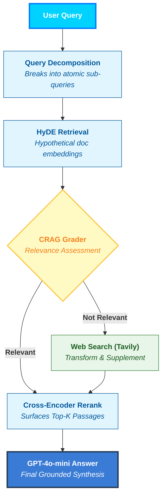

# 🧠 Self-Healing RAG

A production-grade **Self-Healing Retrieval-Augmented Generation** system powered by OpenAI and LangChain/LlamaIndex. The system automatically detects low-quality retrievals, corrects them via web search, decomposes complex queries, and generates precise, grounded answers.

---

## ✨ Features

| Feature | Description |
|---|---|
| 🔍 **Query Decomposition** | Breaks complex questions into atomic sub-queries for better recall |
| 📄 **HyDE Retrieval** | Generates hypothetical answers to improve semantic search accuracy |
| ✅ **CRAG Grading** | Automatically grades each retrieved document for relevance |
| 🌐 **Web Search Fallback** | Triggers Tavily web search when local documents are insufficient |
| 📊 **Cross-Encoder Reranking** | Reranks retrieved docs using a fine-tuned cross-encoder model |
| 💬 **LLM Answer Synthesis** | Synthesizes a grounded, accurate final answer using GPT-4o-mini |
| 🖥️ **Web Interface** | Beautiful, interactive chat UI served via Flask |

---

## 🏗️ Architecture



---

## 🚀 Quick Start

### 1. Clone the Repository

```bash
git clone https://github.com/meenub255/self-healing-rag.git
cd self-healing-rag
```

### 2. Create a Virtual Environment

```bash
python -m venv venv
venv\Scripts\activate        # Windows
# source venv/bin/activate   # Linux / macOS
```

### 3. Install Dependencies

```bash
pip install -r requirements.txt
```

### 4. Configure API Keys

Open `main.py` and `app.py` and replace the placeholder keys:

```python
os.environ["OPENAI_API_KEY"]  = "your-openai-api-key"
os.environ["TAVILY_API_KEY"]  = "your-tavily-api-key"
```

> Get your keys at [platform.openai.com](https://platform.openai.com) and [tavily.com](https://tavily.com)

### 5. Run the Web Interface

```bash
python app.py
```

Visit **http://localhost:5000** in your browser.

### 6. Run CLI Mode (Optional)

```bash
python main.py
```

---

## 📁 Project Structure

```
self-healing-rag/
├── app.py                  # Flask web server & API
├── main.py                 # CLI entry point with interactive loop
├── corrective_rag.py       # CRAG pipeline (LangGraph workflow)
├── hyde.py                 # HyDE retrieval engine (LlamaIndex)
├── query_decomposition.py  # LLM-based query decomposition
├── reranker.py             # Cross-encoder reranking
├── dynamic_prompting.py    # Learning manager (good-example store)
├── requirements.txt        # Python dependencies
├── templates/
│   └── index.html          # Frontend chat UI
└── static/
    └── style.css           # Frontend styles
```

---

## 🧩 Key Components

### `corrective_rag.py` — CRAG Workflow
Uses **LangGraph** to implement a stateful, self-correcting retrieval graph:
- `grade_documents` → LLM evaluates each doc's relevance
- `transform_query` → Rewrites query for web search
- `web_search_node` → Fetches fresh context via Tavily

### `hyde.py` — HyDE Retrieval
Uses **LlamaIndex** `HyDEQueryTransform` to generate a hypothetical document embedding before searching the vector store, dramatically improving recall for abstract questions.

### `reranker.py` — Cross-Encoder Reranking
Uses `cross-encoder/ms-marco-MiniLM-L-6-v2` from **Sentence Transformers** to score query-document pairs and surface the most relevant passages.

---

## 📦 Dependencies

- `openai` / `langchain-openai` — LLM calls
- `langchain` / `langgraph` — CRAG workflow
- `llama-index` — HyDE + vector store
- `sentence-transformers` — Cross-encoder reranker
- `langchain-tavily` — Web search fallback
- `flask` — Web interface server

---

## 📄 License

MIT License — feel free to use, modify, and distribute.

---

## 🙌 Acknowledgements

- [Corrective RAG (CRAG)](https://arxiv.org/abs/2401.15884) — Shi et al., 2024
- [HyDE](https://arxiv.org/abs/2212.10496) — Gao et al., 2022
- [LangGraph](https://github.com/langchain-ai/langgraph)
- [LlamaIndex](https://github.com/run-llama/llama_index)
